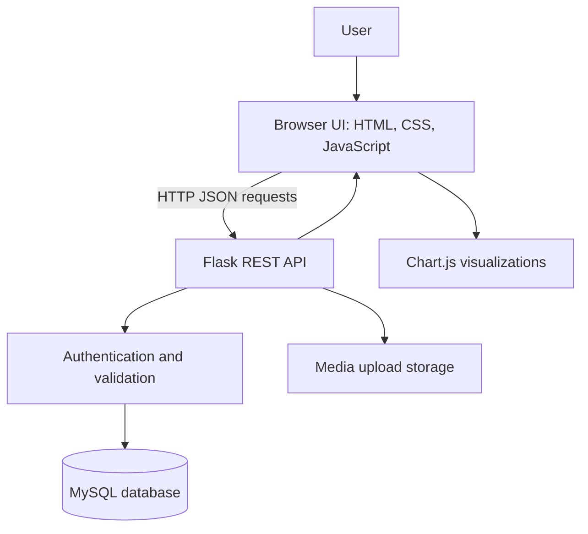

# AdMaster Pro — Project Architecture

**Task:** SWYNEX Technologies Internship — Task 1: Project Architecture  
**Project type:** Full-stack advertising campaign management dashboard

## 1. Product idea

AdMaster Pro is a web dashboard that helps users organize digital advertising campaigns in one place. Users can sign in, view campaign performance, create and manage campaigns and ads, configure target audiences and budgets, upload ad media, and review reports. The dashboard is intended to make campaign information easier to manage and understand.

## 2. Goals and scope

- Provide sign-up and login flows.
- Show dashboard metrics and campaign lists.
- Create and delete campaigns.
- Create ads and upload media.
- Save audience targeting settings.
- Display budget, social platform, and yearly report information.
- Let users update profile information and password.
- Provide responsive layouts for desktop and mobile.

## 3. Technology stack

| Layer | Technology | Responsibility |
|---|---|---|
| Frontend | HTML5, CSS3, Vanilla JavaScript | Screens, forms, navigation, API requests, responsive interface |
| Charts | Chart.js | Visualize campaign and annual performance |
| Backend | Python and Flask | REST API, validation, authentication, business logic, file upload handling |
| Database | MySQL 8 (optional demo fallback) | Store users, campaigns, ads, targeting data, and reports |
| Authentication | JWT-style token using HMAC-SHA256 | Authenticate API requests |
| Configuration | Environment variables / `.env` locally | Store environment-specific settings; secrets must not be committed |

## 4. High-level architecture



The browser renders the user interface and sends HTTP requests to Flask endpoints. Flask validates requests, checks authentication where required, and reads or writes application data through the database layer. Uploaded media is stored under the backend uploads directory and made available through an upload route. Charts are rendered in the browser with Chart.js.

## 5. Data models

### User

| Field | Type / purpose |
|---|---|
| `id` | Primary key |
| `email` | Unique login email |
| `password_hash` | Hashed password; never store plain-text passwords |
| `first_name`, `last_name` | User's display name |
| `role` | Admin or user role |
| `profile_photo` | Optional profile image path |
| `created_at`, `updated_at` | Record timestamps |

### Campaign

| Field | Type / purpose |
|---|---|
| `id` | Primary key |
| `user_id` | Owner; references `users.id` |
| `name` | Campaign name |
| `status` | Active, paused, or completed |
| `platform` | Advertising platform, e.g. Instagram |
| `budget`, `spent` | Budget and amount spent |
| `created_at` | Creation timestamp |

### Ad

An ad belongs to a campaign and includes `campaign_id`, `headline`, `primary_text`, `cta`, optional `media_url`, and `created_at`.

### AudienceTargeting

Stores campaign targeting options: `campaign_id`, `age_min`, `age_max`, `gender`, `location`, `interests` (JSON), and `created_at`.

### Report

Stores monthly campaign metrics: `campaign_id`, `month`, `year`, `revenue`, `cost`, `impressions`, and `clicks`. Each campaign has at most one report per month and year.

### Relationships

- One user can own many campaigns.
- One campaign can have many ads.
- One campaign can have audience-targeting records.
- One campaign can have monthly report records.
- Campaign-owned records are configured to be deleted when their parent campaign is deleted.

## 6. API routes

The following routes are implemented or listed in the project README. Request payloads should be validated and protected routes should require a valid token.

| Method | Route | Purpose |
|---|---|---|
| `POST` | `/api/auth/login` | Authenticate a user and return a token |
| `POST` | `/api/auth/signup` | Register a user |
| `POST` | `/api/auth/forgot-password` | Start password recovery flow |
| `GET` | `/api/dashboard/stats` | Retrieve dashboard metrics |
| `GET` | `/api/campaigns` | List campaigns, with pagination support |
| `POST` | `/api/campaigns` | Create a campaign |
| `DELETE` | `/api/campaigns/<id>` | Delete a campaign |
| `POST` | `/api/create-ad` | Create/save an ad |
| `GET`, `POST` | `/api/target-audience` | Read or save audience targeting |
| `GET` | `/api/budget-billing` | Retrieve budget and billing information |
| `GET` | `/api/social-media` | Retrieve social platform information |
| `GET` | `/api/reports/yearly` | Retrieve annual report data |
| `GET`, `POST` | `/api/settings/profile` | Read or update profile settings |
| `POST` | `/api/settings/update-password` | Change password |
| `POST` | `/api/upload/media` | Upload ad media |
| `GET` | `/api/health` | Check API/server health |
| `GET` | `/api/db-status` | Check database connection status |

## 7. Frontend screens

1. **Login** — existing users authenticate.
2. **Create Account** — new users register.
3. **Reset Password** — begin password recovery.
4. **Dashboard** — campaign metrics, performance overview, and platform distribution.
5. **Campaigns** — browse and manage campaigns.
6. **Create Ad** — enter ad content, upload media, and preview the ad.
7. **Target Audience** — configure demographics, location, interests, and behavior.
8. **Budget & Billing** — review budget, payment method, and transaction history.
9. **Social Media** — view supported social platforms.
10. **Reports** — view annual performance charts and export report data.
11. **Settings** — manage profile, password, and preferences.

## 8. Main user flow

1. A user opens the application and signs in or creates an account.
2. The frontend requests dashboard metrics from the Flask API.
3. The user creates a campaign and configures platform and budget details.
4. The user creates an ad, adds copy and media, and configures the target audience.
5. The backend stores data in MySQL when available, or uses the project's demo fallback where supported.
6. The user reviews campaign and yearly performance information in the dashboard and reports screens.

## 9. Security, reliability, and future improvements

- Keep `.env`, database passwords, signing keys, tokens, and other secrets out of GitHub. Rotate any secret that has already been exposed.
- Use password hashing, validate all request data, and enforce authentication and ownership checks on private campaign data.
- Restrict upload file types and sizes; use safe generated filenames and avoid executing uploaded files.
- Use HTTPS and secure cookie/token handling in production.
- Add automated tests for authentication, campaign CRUD, upload validation, and report calculations.
- Add database migrations, structured logging, and clearer error responses.
- Verify that password recovery actually uses a secure, expiring reset token before deploying.
- Document which endpoints require authentication and define consistent response formats.

## 10. Run locally

1. Install Python 3.8+ (a newer compatible version is fine) and the dependencies in `backend/requirements.txt`.
2. Configure local database settings using environment variables or a local `.env` file. Do not publish credentials.
3. From the backend directory, run `pip install -r requirements.txt` and then `python app.py`.
4. Open the local address printed by Flask, typically `http://localhost:5000`.
5. Check `/api/health` to confirm the server is responding. Test database-dependent functionality according to the project's demo/database configuration.

## 11. Repository structure

```text
SWYNEX-Project-Architecture/
├── ARCHITECTURE.md
├── README.md
├── .gitignore
├── frontend/
│   ├── index.html
│   ├── style.css
│   └── script.js
└── backend/
    ├── app.py
    ├── database.sql
    ├── requirements.txt
    └── uploads/        # Do not commit private or unnecessary uploaded files
```

This document describes the current project structure and intended behavior based on the supplied source files. Test the application and verify endpoint behavior before describing any feature as production-ready.
